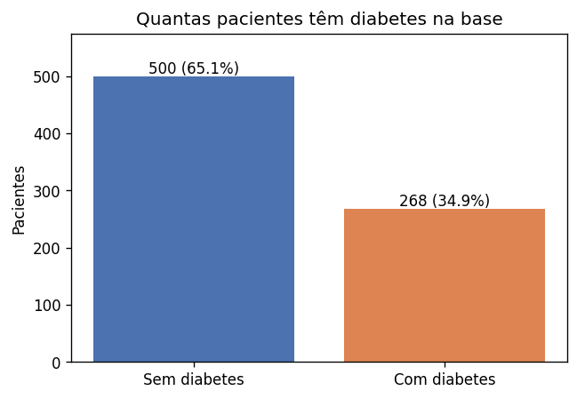
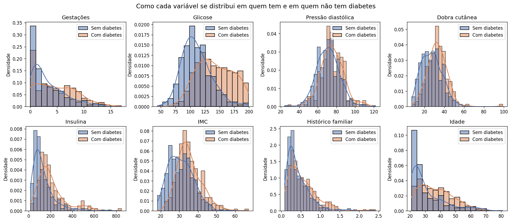
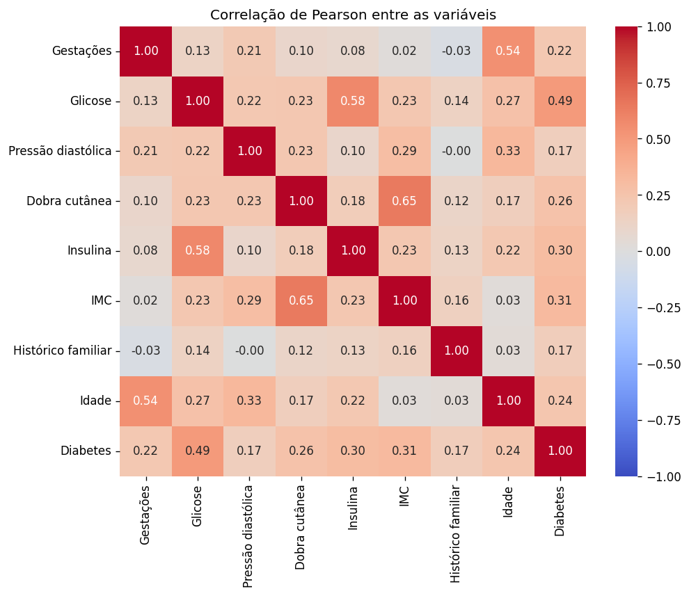
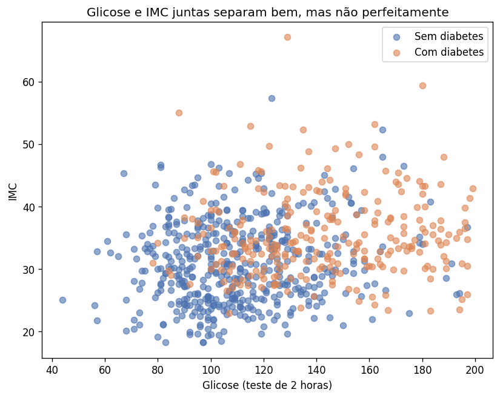
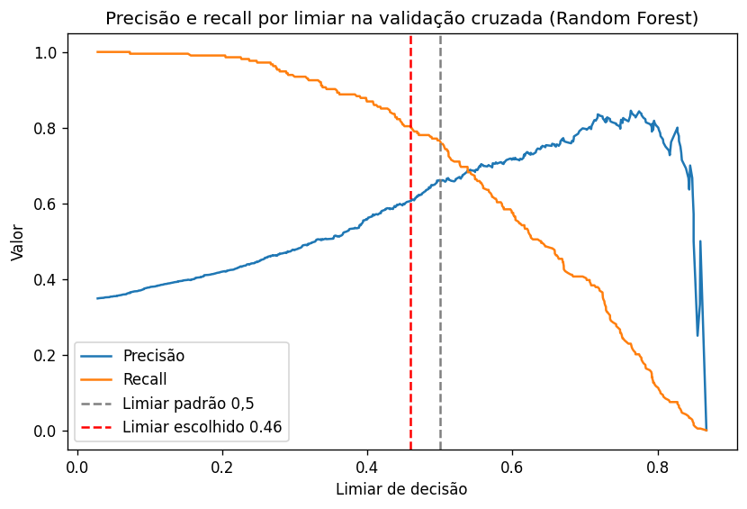
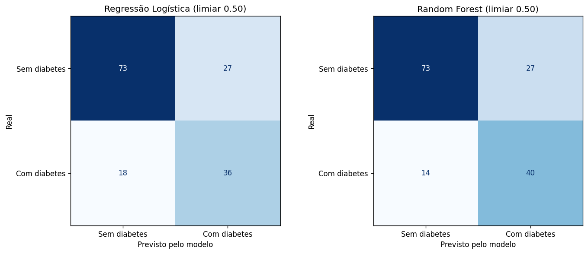
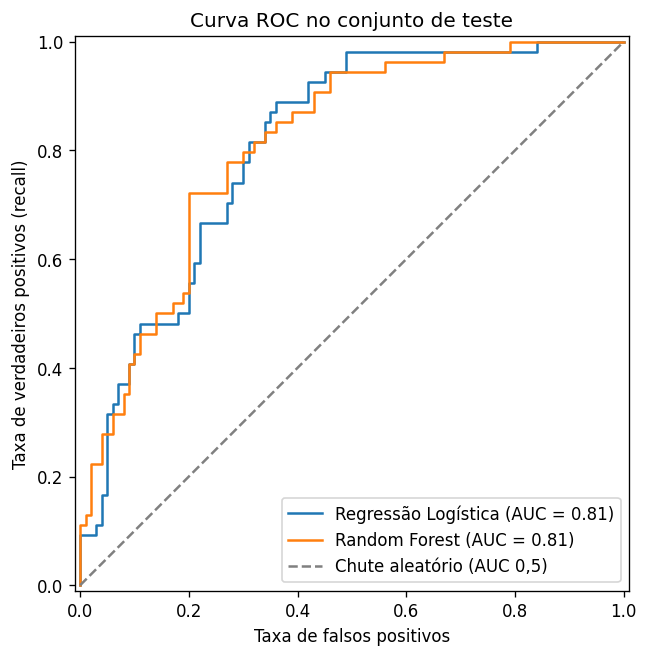
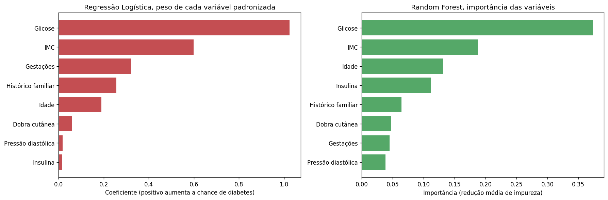
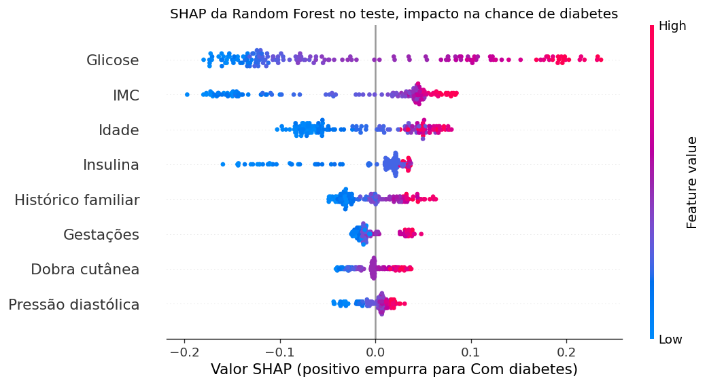
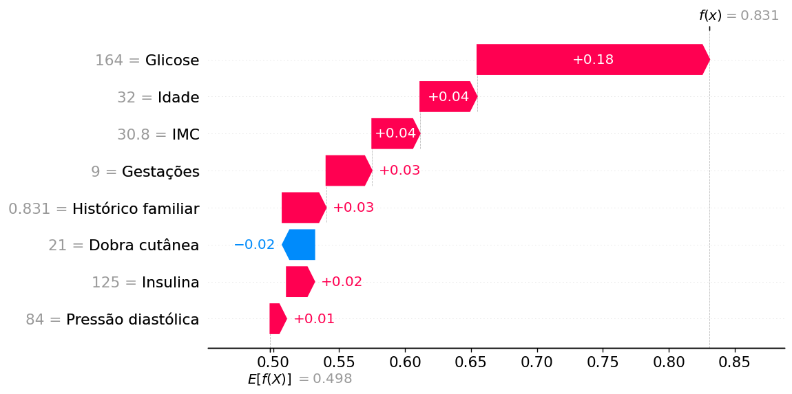

# 1. O problema

A proposta do Tech Challenge era criar uma solução de IA que ajudasse médicos a fazer diagnóstico. Escolhi trabalhar com diabetes, que é um problema de classificação binária. A partir de dados clínicos simples, o modelo diz se a paciente tem ou não tem diabetes.

O objetivo não é substituir o médico. A ideia é ter uma ferramenta de triagem que aponte quem merece um olhar mais cuidadoso e um exame confirmatório. Por isso, desde o começo, defini que o erro mais grave seria deixar passar uma paciente com diabetes, e isso guiou a escolha das métricas.

Para organizar o trabalho segui as etapas do CRISP-DM que vimos em Fundamentos de IA. Entender o problema, entender os dados, preparar, modelar, avaliar e discutir a implantação.

O código está no repositório do GitHub, com o notebook da análise, um script que roda tudo do zero, o Dockerfile e o README com as instruções.

# 2. A base de dados

Usei a Pima Indians Diabetes, indicada no enunciado. Ela tem 768 pacientes, todas mulheres com 21 anos ou mais da população Pima, e as seguintes variáveis.

| Variável | O que é |
|---|---|
| Pregnancies | Número de gestações |
| Glucose | Glicose no teste oral de tolerância de 2 horas |
| BloodPressure | Pressão diastólica (mm Hg) |
| SkinThickness | Dobra cutânea do tríceps (mm) |
| Insulin | Insulina sérica de 2 horas |
| BMI | Índice de massa corporal |
| DiabetesPedigreeFunction | Indicador de histórico familiar |
| Age | Idade em anos |
| Outcome | 1 com diabetes, 0 sem diabetes |

A base não tem linhas duplicadas nem valores nulos declarados. O alvo é desbalanceado, com 500 pacientes sem diabetes (65,1%) e 268 com diabetes (34,9%). Isso quer dizer que um modelo que chuta sempre "sem diabetes" já acerta 65%, e é por isso que a acurácia sozinha não serve para avaliar este problema.

{width=55%}

# 3. Preparação dos dados

## 3.1 Zeros que são dado faltando

No describe apareceu o principal problema da base. Cinco variáveis têm valor mínimo igual a zero, o que é impossível numa pessoa viva. Esses zeros são dado faltando disfarçado.

| Variável | Zeros | Percentual |
|---|---|---|
| Insulina | 374 | 48,7% |
| Dobra cutânea | 227 | 29,6% |
| Pressão diastólica | 35 | 4,6% |
| IMC | 11 | 1,4% |
| Glicose | 5 | 0,7% |

Apagar essas linhas jogaria fora 376 pacientes, quase metade da base. Por isso troquei os zeros por vazio (NaN) e preenchi com a **mediana**, que sofre menos com valores extremos do que a média. Gestações igual a zero é um valor real e ficou de fora da troca.

## 3.2 Sem vazamento de informação

A mediana e a padronização foram colocadas **dentro do Pipeline do scikit-learn**. Assim elas são calculadas só com os dados de treino de cada dobra da validação cruzada e aplicadas depois no que o modelo não viu. Se eu calculasse a mediana na base inteira antes de separar, o teste estaria contaminando o treino, que é um erro que aparece em alguns notebooks das aulas e que eu quis evitar.

## 3.3 Valores extremos

Insulina e dobra cutânea têm valores bem altos. Não removi esses pontos porque são clinicamente possíveis e a base já é pequena. Para a Regressão Logística usei o StandardScaler, e a Random Forest não precisa de escala porque as árvores só comparam valores.

## 3.4 Variáveis categóricas

Todas as variáveis da base são numéricas, então não foi preciso usar one-hot encoding nem label encoding.

# 4. Análise exploratória

Comparando as medianas dos dois grupos, quem tem diabetes tem glicose bem mais alta (140 contra 107), IMC maior (34,3 contra 30,1), é mais velha (36 contra 27 anos) e teve mais gestações (4 contra 2).



A glicose é a variável que mais separa os grupos. IMC, idade e gestações também deslocam a curva, mas com muito mais mistura entre quem tem e quem não tem diabetes.

## 4.1 Correlação

Calculei a correlação de Pearson entre todas as variáveis.

{width=70%}

Com o diagnóstico, a glicose tem a correlação mais forte (0,49), seguida de IMC (0,31) e insulina (0,30). Entre as variáveis, idade e gestações andam juntas (0,54), assim como IMC e dobra cutânea (0,65) e glicose e insulina (0,58). Nenhuma correlação é tão alta a ponto de obrigar a remover variáveis.

Correlação não é causa. Ela mostra o que anda junto, mas não prova que uma variável provoca a outra.

{width=60%}

O gráfico de glicose com IMC resume bem o desafio. As duas juntas separam boa parte das pacientes, mas sobra uma região grande de mistura no meio. É ali que o modelo vai errar.

# 5. Modelagem

## 5.1 Separação dos dados

Separei 20% das pacientes para teste (154) e 80% para treino (614), mantendo a proporção de diabetes nos dois lados com `stratify`. Fixei `random_state=42` para que qualquer pessoa chegue nos mesmos números.

O teste ficou guardado e foi usado **uma única vez**, no final. Toda escolha de modelo, de hiperparâmetro e de limiar foi feita com validação cruzada estratificada de 5 dobras dentro do treino. Assim o treino e a validação acontecem sempre em partes diferentes dos dados, e o teste continua sendo uma prova que o modelo nunca viu.

## 5.2 Modelos escolhidos

| Modelo | Por que escolhi |
|---|---|
| Modelo base (DummyClassifier) | Chuta sempre a classe mais comum. É o piso que qualquer modelo precisa superar |
| Regressão Logística | Simples, rápida e fácil de explicar, porque cada variável recebe um peso. Precisa de escala |
| Random Forest | Várias árvores de decisão que votam juntas. Pega relações não lineares, não precisa de escala e combina bem com SHAP |

## 5.3 Hiperparâmetros

Usei o GridSearchCV com validação cruzada estratificada, otimizando o **F1**, que equilibra precisão e recall.

| Modelo | Grade testada | Escolhido |
|---|---|---|
| Regressão Logística | C em 0,01, 0,1, 1, 10 e class_weight None ou balanced | C 0,1 e class_weight balanced |
| Random Forest | 200 ou 400 árvores, profundidade 4, 6, 8 ou livre, mínimo por folha 1, 5 ou 10, class_weight None ou balanced | 400 árvores, profundidade 4, mínimo de 10 por folha, class_weight balanced |

Nos dois modelos o `class_weight="balanced"` venceu. Ele dá mais peso às pacientes com diabetes durante o treino e compensa o desequilíbrio da base. Na Random Forest venceram árvores rasas e folhas com pelo menos 10 pacientes, o que evita decorar a base de treino. Testei também otimizar direto pelo recall e os hiperparâmetros escolhidos foram os mesmos.

# 6. Avaliação

## 6.1 Qual métrica importa

| Termo | No nosso caso |
|---|---|
| Verdadeiro positivo | Tem diabetes e o modelo apontou |
| Falso negativo | Tem diabetes e o modelo **não** apontou. É o erro mais grave |
| Falso positivo | Não tem diabetes e o modelo apontou. Gera um exame a mais |
| Verdadeiro negativo | Não tem diabetes e o modelo não apontou |

O falso negativo é uma paciente doente que vai para casa sem acompanhamento. Por isso o **recall da classe com diabetes** é a métrica principal. O F1 entra para não deixar a precisão despencar, porque falso positivo demais sobrecarrega o médico. A ROC AUC mostra se o modelo ordena bem as pacientes por risco, e a acurácia fica só como referência.

## 6.2 Validação cruzada no treino

Média e desvio das 5 dobras.

| Modelo | Acurácia | Precisão | Recall | F1 | ROC AUC |
|---|---|---|---|---|---|
| Modelo base | 0,651 ± 0,002 | 0,000 | 0,000 | 0,000 | 0,500 |
| Regressão Logística | 0,767 ± 0,008 | 0,651 ± 0,020 | 0,720 ± 0,050 | 0,682 ± 0,017 | 0,845 ± 0,013 |
| Random Forest | 0,780 ± 0,015 | 0,662 ± 0,029 | 0,762 ± 0,017 | 0,707 ± 0,010 | 0,840 ± 0,020 |

Os dois modelos passam bem do modelo base. A Random Forest fica à frente em recall e F1 e é mais estável no recall (desvio de 0,017 contra 0,050). Já a ROC AUC dos dois é praticamente igual, com diferença menor que o desvio entre as dobras.

## 6.3 Ajuste do limiar

Por padrão o modelo aponta "com diabetes" quando a probabilidade passa de 0,5. Como o recall é a prioridade, procurei um limiar mais baixo para a Random Forest. Usei as probabilidades da validação cruzada do treino, nunca o teste, e escolhi o limiar com a maior precisão possível garantindo recall de pelo menos 80%. O resultado foi **0,46**.

{width=70%}

## 6.4 Resultado no teste

| Modelo | Limiar | Acurácia | Precisão | Recall | F1 | ROC AUC |
|---|---|---|---|---|---|---|
| Regressão Logística | 0,50 | 0,708 | 0,571 | 0,667 | 0,615 | 0,810 |
| Random Forest | 0,50 | 0,734 | 0,597 | 0,741 | 0,661 | 0,814 |
| Random Forest | 0,46 | 0,721 | 0,573 | **0,796** | 0,667 | 0,814 |



Das 54 pacientes com diabetes do teste, a Regressão Logística encontrou 36 e a Random Forest 40. Com o limiar ajustado a Random Forest chegou a 43, em troca de 5 falsos positivos a mais.

{width=60%}

As duas curvas ROC ficam bem acima da diagonal do chute aleatório e muito próximas entre si, o que confirma o que a validação cruzada já mostrava.

Os números do teste ficaram um pouco abaixo da validação cruzada. Isso é esperado com só 154 pacientes, em que cada paciente com diabetes vale quase 2 pontos de recall. Por isso tomei as decisões olhando a média e o desvio da validação cruzada e usei o teste só para confirmar.

**Modelo escolhido.** Random Forest com limiar 0,46, por ter o maior recall com F1 e ROC AUC iguais ou melhores. A Regressão Logística continua sendo uma ótima opção quando a prioridade for explicar cada peso de forma simples.

# 7. Interpretação dos modelos

## 7.1 Pesos e importância das variáveis



Os dois modelos concordam no principal. **Glicose** é de longe a variável mais importante, seguida de **IMC** e **idade**. Na Regressão Logística, a razão de chances mostra que cada desvio padrão a mais de glicose multiplica a chance de diabetes por cerca de 2,8, e o IMC por cerca de 1,8.

Para a Random Forest conferi a importância por impureza com a importância por permutação no teste, que mede quanto a ROC AUC cai quando embaralho cada variável. As duas mostram a mesma ordem nas três primeiras posições.

## 7.2 SHAP

{width=85%}

No gráfico do SHAP cada ponto é uma paciente do teste. A cor mostra o valor da variável e a posição mostra se ela empurrou a previsão para "com diabetes" (direita) ou para "sem diabetes" (esquerda). Glicose alta, IMC alto e idade maior empurram para a direita, que é exatamente o que a medicina espera. Isso dá confiança de que o modelo aprendeu um padrão que faz sentido, e não uma coincidência da base.

{width=80%}

O SHAP também explica uma paciente por vez. Nesse exemplo o modelo partiu da média (cerca de 0,50) e chegou a 0,83 de probabilidade, puxado principalmente pela glicose de 164. É esse tipo de explicação que permite ao médico conferir e questionar o modelo.

# 8. Discussão crítica

**Dá para usar na prática?** Como apoio à triagem, sim. O modelo pode ajudar a priorizar quem deve fazer exames confirmatórios. Como diagnóstico sozinho, não. O médico tem a palavra final.

Os limites que precisam ficar claros são estes.

- **População específica.** A base tem só mulheres Pima com 21 anos ou mais. Não dá para garantir o mesmo resultado em homens, em outras etnias ou em grupos com metabolismo diferente, como pessoas que fizeram cirurgia bariátrica.
- **Tipo de exame.** A glicose da base é do teste oral de 2 horas, não a de jejum. Usar o modelo com glicose de jejum seria aplicar fora do que ele aprendeu.
- **Dados faltando.** Quase metade dos valores de insulina era faltante. A mediana preenche o buraco, mas não traz a informação real.
- **Ainda erra.** Mesmo com o limiar ajustado, o modelo deixou passar 11 das 54 pacientes com diabetes no teste. Por isso ele não pode ser o único filtro.
- **Base pequena e antiga.** São 768 pacientes. Antes de qualquer uso real seria preciso validar com dados atuais da população em que o modelo vai rodar e acompanhar o desempenho ao longo do tempo, porque os dados mudam (data drift).

# 9. Como reproduzir

Tudo roda com Docker.

```
docker build -t tech-challenge-fase1 .
docker run --rm tech-challenge-fase1
```

O README do repositório explica também como salvar os gráficos na sua máquina, como abrir o notebook pelo Docker e como rodar sem Docker. As versões das bibliotecas estão fixas no `requirements.txt` e todas as divisões usam `random_state=42`, então os números deste relatório se repetem em qualquer máquina.

# 10. Conclusão

Consegui montar um modelo que encontra cerca de 8 em cada 10 pacientes com diabetes, com ROC AUC de 0,81 no teste, usando só dados clínicos simples. Mais do que o número, o que me importou foi o caminho. Tratar os zeros como dado faltando, não vazar informação do teste, escolher a métrica pelo custo do erro e conseguir explicar cada previsão. O modelo mostra que dá para usar machine learning como apoio na saúde, desde que fique claro até onde ele vai e que a decisão final continua sendo do médico.
